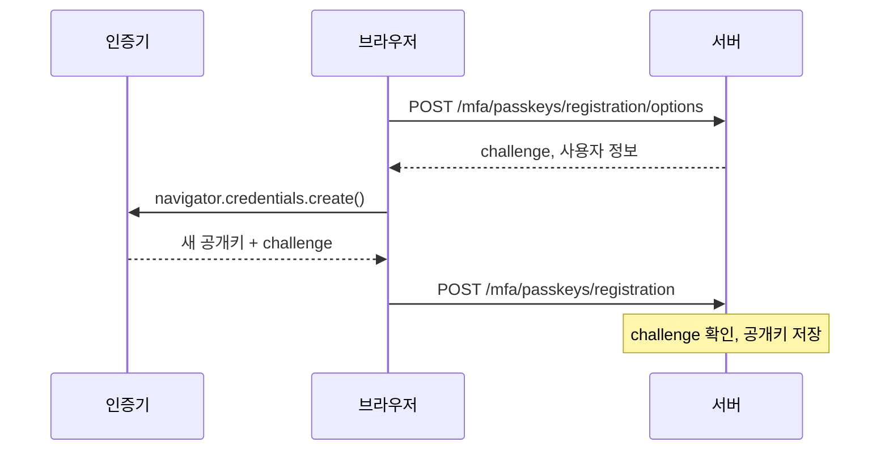
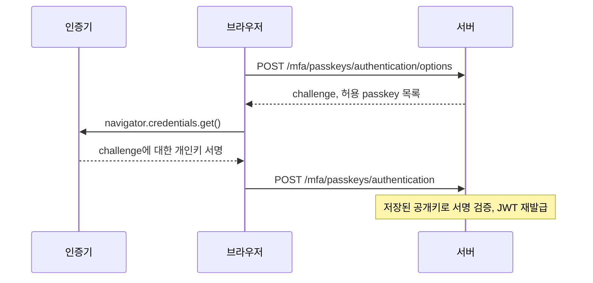

# spring-mfa

- Spring Boot 4.1.2, Spring Security 7.1.2 기반 passkey 2차 인증 샘플
- `/admin/**`: password 로그인 후 passkey 인증까지 완료해야 접근 가능

## 흐름

### 등록

### 인증

- options 호출과 결과 제출 사이에 인증기 처리가 있어 서버 호출이 2번으로 분리됨
- challenge: 서버 발급 일회용 값, 응답 재사용 공격 차단

## Spring Security WebAuthn 지원

- WebAuthn 등록, 인증 처리: `WebAuthnRelyingPartyOperations` 메서드 4개가 담당

### 1. 등록 준비: `createPublicKeyCredentialCreationOptions()`

- 랜덤 challenge 생성
- 사용자 식별자(user handle) 발급 후 저장소에 저장
- 이미 등록된 passkey를 제외 목록(`excludeCredentials`)에 포함
- 브라우저 `navigator.credentials.create()`에 바로 넘길 옵션 객체 반환

### 2. 등록 완료: `registerCredential()`

- 브라우저 응답의 attestation 객체 파싱
- challenge 일치 여부 확인
- origin, rpId가 설정값과 같은지 확인
- 응답에서 공개키 추출
- 공개키, credential ID, 서명 카운터를 `CredentialRecord`로 만들어 저장소에 저장

### 3. 인증 준비: `createCredentialRequestOptions()`

- 랜덤 challenge 생성
- 현재 사용자의 passkey 목록을 허용 목록(`allowCredentials`)에 포함
- 브라우저 `navigator.credentials.get()`에 바로 넘길 옵션 객체 반환

### 4. 인증 완료: `authenticate()` (`WebAuthnAuthenticationProvider`가 호출)

- 저장된 공개키로 브라우저 응답의 서명 검증
- challenge, origin, rpId 확인
- 서명 카운터 비교로 복제된 인증기 감지, 카운터 갱신
- 검증 성공 시 사용자 조회 후 `FACTOR_WEBAUTHN` 권한이 담긴 `Authentication` 반환

### 기타 지원

- 저장소 인터페이스와 구현체: in-memory(`Map*`), JDBC(`Jdbc*`)
- WebAuthn 요청, 응답 객체의 JSON 변환: `WebauthnJacksonModule`
- "password와 passkey 모두 필요, passkey는 10분간 유효" 같은 접근 조건: `AllRequiredFactorsAuthorizationManager`
- `http.webAuthn { }` 설정 시 위 과정을 처리하는 필터와 기본 등록 페이지 자동 구성

## 샘플 구현

- `http.webAuthn { }` 미사용, 세션 기반 1차 로그인 용도라 JWT 기반 2차 인증과 맞지 않음
- `PasskeyController`: 위 메서드 4개를 API로 노출
- `PendingCeremonyStore`: 발급한 옵션(challenge)을 응답이 올 때까지 사용자별로 보관
- `JpaPasskeyRepositories`: 저장소 인터페이스의 JPA 구현
- `FactorTokenService`: passkey 인증 결과를 기존 password 인증과 합쳐 JWT 재발급

## 실행

- 계정: `admin`/`password`(ADMIN), `user`/`password`
- 브라우저: `http://localhost:8080`
- 테스트: webauthn4j-test 에뮬레이터 사용

## 참고

- [Spring Security Passkeys](https://docs.spring.io/spring-security/reference/servlet/authentication/passkeys.html)
- [Spring Security Multi-Factor Authentication](https://docs.spring.io/spring-security/reference/servlet/authentication/mfa.html)
- [W3C Web Authentication Level 3](https://www.w3.org/TR/webauthn-3/)
